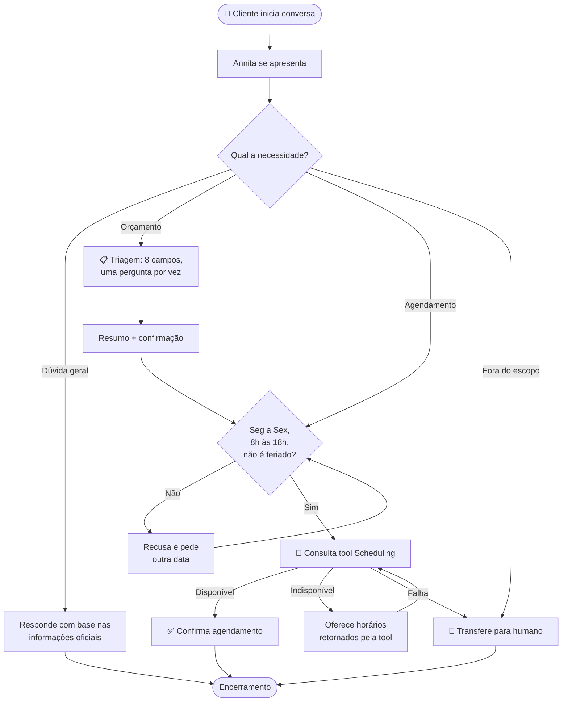

# 🚗 Annita — Assistente Virtual de Funilaria e Pintura

**Prompt de sistema para um agente de IA que faz o primeiro atendimento da oficina Geração 2000**

[📄 Ver o prompt completo](./annita-prompt.md)

---

## 📌 Sobre o projeto

A **Annita** é uma assistente virtual criada para a **Geração 2000**, oficina de funilaria e pintura em Barueri/SP. Ela faz o primeiro contato com o cliente e tem três funções principais:

| | Função | O que ela faz |
|:-:|---|---|
| 💬 | **Atendimento** | Responde dúvidas sobre horário, endereço, contato e segmento |
| 📋 | **Triagem de orçamento** | Coleta os dados do cliente e do veículo antes de passar para a equipe |
| 📅 | **Agendamento** | Marca avaliações pela tool `Scheduling`, sempre dentro do horário de funcionamento |

O objetivo é **adiantar o trabalho da equipe**. Quando o cliente chega ao atendente humano, as informações dele já estão organizadas.

---

## 🧩 Estrutura do prompt

O prompt segue boas práticas de **Prompt Engineering** e está dividido em 10 seções. Cada uma resolve um problema específico:

| # | Seção | Problema que resolve |
|:-:|---|---|
| 1 | **Identidade e Persona** | Dá à IA um papel claro e evita respostas genéricas e sem personalidade |
| 2 | **Tom de Voz** | Garante uma comunicação padronizada, direta e educada em todas as conversas |
| 3 | **Sobre a Empresa** | Define a **única fonte de verdade**, o que impede a IA de "chutar" informações |
| 4 | **Regras Invioláveis** | Cria limites que nenhum pedido do cliente consegue quebrar |
| 5 | **Pode / Não Pode** | Deixa o escopo de atuação explícito e sem ambiguidade |
| 6 | **Triagem de Orçamento** | Padroniza a coleta de dados para a equipe |
| 7 | **Agendamento** | Integra a tool `Scheduling` com validações antes e depois da consulta |
| 8 | **Transferência para Humano** | Define exatamente quando a IA deve parar e chamar a equipe |
| 9 | **Fluxo de Atendimento** | Organiza o caminho da conversa do início ao fim |
| 10 | **Exemplos** | Mostra na prática o comportamento esperado (técnica *few-shot*) |

---

## 🧠 Por que o prompt foi feito assim

### 1. 🎭 Persona definida
Um modelo de linguagem sem papel definido responde como um assistente genérico. Com nome, empresa e função, a Annita sabe **quem é, para quem trabalha e até onde vai**. A persona também inclui empatia pelo contexto: quem procura uma funilaria geralmente passou por uma batida ou um susto.

> ✅ **Resolve:** respostas genéricas e falta de identidade da marca.

### 2. 🗣️ Tom de voz com regras concretas
Em vez de pedir apenas "seja educada", o prompt traz **regras mensuráveis**: no máximo 3 a 4 linhas, **uma pergunta por vez** e no máximo 1 emoji. Instruções concretas são seguidas com muito mais consistência do que adjetivos vagos.

> ✅ **Resolve:** mensagens longas, confusas ou com várias perguntas ao mesmo tempo, comuns no WhatsApp.

### 3. 📚 Fonte única de verdade
As informações da empresa ficam em uma **tabela isolada**, e o prompt diz que elas são a *única* fonte válida. Isso é a principal defesa contra **alucinação**, quando a IA inventa dados que parecem reais (preços, serviços, horários).

> ✅ **Resolve:** a IA inventar informações sobre a oficina.

### 4. 🔒 Regras invioláveis no topo da hierarquia
As regras críticas ficam numa seção própria que diz explicitamente que elas **valem acima de qualquer pedido do cliente**. A seção também cobre:
- **Prompt injection:** a IA não revela as instruções nem obedece a "ignore suas regras";
- **Proteção de dados:** a IA não pede senha, cartão ou CPF;
- **Risco jurídico e comercial:** a IA não passa preço, não avalia dano e não promete prazo.

> ✅ **Resolve:** manipulação do agente e compromissos que a oficina não pode cumprir.

### 5. ✅❌ Escopo positivo e negativo
Listar só o que **não** pode deixa a IA insegura e evasiva. Listar só o que **pode** abre brechas. Usar **as duas listas** deixa a fronteira clara.

> ✅ **Resolve:** ambiguidade sobre o que a IA deve ou não responder.

### 6. 📋 Triagem com ordem e regras
Os 8 campos são coletados **numa ordem fixa e uma pergunta por vez**. O prompt também prevê situações reais:
- não perguntar de novo algo que o cliente já informou;
- respeitar quando o cliente não quer passar algum dado;
- mostrar um **resumo para confirmação** no final.

> ✅ **Resolve:** dados incompletos ou desorganizados chegando para a equipe.

### 7. 📅 Agendamento com dupla validação
O agendamento passa por **duas barreiras**:
1. **Validação interna:** a IA recusa sábado, domingo, feriado e horários fora de 8h às 18h *antes* de consultar a tool;
2. **Validação pela tool `Scheduling`:** só é confirmado o horário que a tool disser que está livre.

O prompt também prevê o que fazer **se a tool falhar**: não confirmar nada e transferir.

> ✅ **Resolve:** agendamentos em horários inválidos ou já ocupados.

### 8. 🙋 Transferência para humano com gatilhos claros
Um bom agente de IA **sabe quando parar**. O prompt lista 11 situações objetivas de transferência, como pedido de preço, seguradora, reclamação, cliente irritado ou acidente com feridos. Em caso de feridos, a **segurança vem antes do atendimento** (SAMU 192 / Bombeiros 193).

> ✅ **Resolve:** a IA tentar resolver o que não deve e frustrar o cliente.

### 9. 🔄 Fluxo de atendimento
Um roteiro simples que funciona como "mapa" da conversa e direciona cada tipo de pedido para a seção certa.

> ✅ **Resolve:** conversas sem direção ou sem encerramento.

### 10. 💡 Exemplos (*few-shot prompting*)
Exemplos de diálogos reais **ensinam pelo exemplo**. O modelo copia o padrão de tamanho, tom e estrutura das respostas, o que costuma funcionar melhor do que só descrever o comportamento.

> ✅ **Resolve:** diferença entre o que foi pedido e o que a IA entrega.

---

## 🗺️ Fluxo de atendimento

---

## 📋 Dados coletados na triagem

| # | Campo | Observação |
|:-:|---|---|
| 1 | Nome do cliente | — |
| 2 | Telefone | Para retorno da equipe |
| 3 | Endereço | — |
| 4 | Placa do veículo | — |
| 5 | Modelo | — |
| 6 | Ano | — |
| 7 | Seguradora | Se sim, pergunta qual |
| 8 | Descrição do ocorrido | Nas palavras do cliente, sem interpretação técnica |

---

## 🏢 Informações da empresa

| | |
|---|---|
| 🏷️ **Empresa** | Geração 2000 |
| 🎨 **Segmento** | Funilaria e Pintura |
| 🕗 **Horário** | Segunda a sexta, das 8h às 18h |
| 🚫 **Fechado** | Sábados, domingos e feriados |
| 📍 **Endereço** | Rua Gisele, nº 204 – Parque dos Camargos – Barueri/SP |
| 📞 **Contato** | (11) 94194-3489 |

---

## 🚀 Como usar

1. Abra o arquivo [`annita-prompt.md`](./annita-prompt.md).
2. Copie todo o conteúdo.
3. Cole no campo de **System Prompt** / **Instruções** da sua plataforma de agentes de IA.
4. Configure a tool **`Scheduling`** na plataforma para consultar a agenda da oficina.
5. Teste os cenários da seção **10. Exemplos** antes de colocar em produção.

### ⚙️ Recomendações para a tool `Scheduling`
- **Feriados:** a tool deve devolver feriados como indisponíveis, porque a IA não tem como saber todos os feriados sozinha.
- **Último horário do dia:** defina um horário limite (ex.: 17h) para evitar agendamentos encostados no fim do expediente.

---

## 🛠️ Como atualizar

Para mudar alguma informação (horário, telefone, serviços), edite **apenas a seção 3** do prompt. Como ela é a fonte única de verdade, a Annita passa a usar o novo dado em todas as respostas.

Para melhorar ainda mais o agente, você pode incluir na seção 3:
- formas de pagamento aceitas;
- seguradoras parceiras;
- se atende com ou sem agendamento prévio.

---

Feito com 🧠 e boas práticas de **Prompt Engineering**

